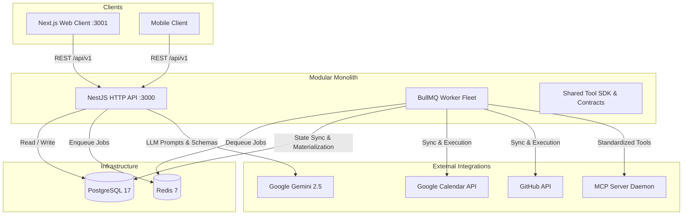
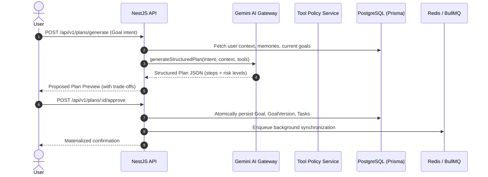

# Architecture Specification: Personal AI Agent Platform

## 1. System Overview

The **Personal AI Agent Platform** (`adaptive-planner`) is an AI-orchestrated planning companion designed around psychological safety, realistic capacity estimation, and proactive recovery. It connects a user's authorized productivity applications, understands high-level goals, coordinates tasks across providers, and adapts plans based on actual velocity.

### Core Architectural Decisions
- **Modular Monolith:** A unified TypeScript codebase housing the HTTP API (`apps/api`) and the background job processor (`apps/worker`), sharing contracts (`packages/contracts`), tool SDK (`packages/tool-sdk`), and database schemas (`prisma/`).
- **PostgreSQL 17 as System of Record:** Every critical business entity (goals, tasks, connections, approvals, audit logs) is stored relationally. JSONB is reserved strictly for provider payloads and model metadata.
- **Prisma ORM 7:** Type-safe database queries, declarative migrations, and relational integrity.
- **Redis 7 + BullMQ:** Asynchronous background job processing for plan synthesis, recurring schedule reconciliation, webhook ingestion, and resilient tool execution.
- **Provider-Independent AI Model Gateway:** An internal gateway abstraction (`IModelGateway`) defaulting to **Google Gemini** (`gemini-2.5-flash`), enforcing structured JSON schemas, timeouts, and fallback resilience.
- **Explicit Risk & Human-in-the-Loop Policies:** Model actions are segregated into 5 risk tiers. High-impact or sensitive operations require server-side human approval before execution.

---

## 2. Component Topology



---

## 3. Modular Monolith Directory Structure

```
adaptive-planner/
├── apps/
│   ├── api/                   # NestJS HTTP API
│   │   └── src/
│   │       ├── health/        # /health/live, /health/ready
│   │       ├── identity/      # /me, user & workspace auth
│   │       ├── goals/         # Goals CRUD & versioning
│   │       ├── tasks/         # Tasks CRUD & today focus
│   │       ├── planning/      # Proposed plan generation & approval
│   │       ├── agent/         # Model gateway (Gemini) & pipeline
│   │       ├── tools/         # Registry, risk policy & approvals
│   │       ├── integrations/  # Adapters (Google Calendar, GitHub, MCP)
│   │       ├── notifications/ # User preferences & scheduled reminders
│   │       ├── events/        # Webhook ingestion & deduplication
│   │       ├── audit/         # Immutable audit logging
│   │       └── memory/        # Preference & fact retention
│   ├── worker/                # BullMQ Worker Fleet
│   └── web/                   # Next.js Frontend Dashboard
├── packages/
│   ├── contracts/             # Shared DTOs, interfaces & enums
│   ├── tool-sdk/              # IntegrationAdapter & ToolDefinition
│   └── config/                # Environment validation & loading
├── prisma/
│   ├── schema.prisma          # 16 Relational models
│   └── seed.ts                # Development seed script
├── infra/
│   ├── docker/                # Multi-stage Dockerfiles
│   └── observability/         # OpenTelemetry setup
└── docs/                      # Architectural specifications
```

---

## 4. Execution Pipeline


