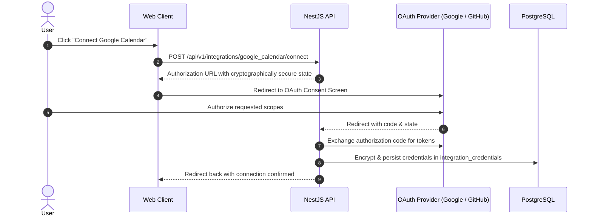

# Integrations Specification: Adapter Architecture & Protocol Guidelines

## 1. Adapter Contract

All integration providers implement the `IntegrationAdapter` contract from `@adaptive-planner/tool-sdk`:

```typescript
export interface IntegrationAdapter {
  readonly providerId: string;
  readonly displayName: string;
  readonly description: string;
  listTools(): ToolDefinition[];
  execute(
    toolName: string,
    input: unknown,
    context: AuthorizedExecutionContext,
  ): Promise<ToolResult>;
  checkConnection(
    context: AuthorizedExecutionContext,
  ): Promise<ConnectionHealth>;
}
```

---

## 2. Supported Adapters

### Google Calendar (`google_calendar`)
- **Category:** Calendar & Scheduling
- **Scopes:** `calendar.events.readonly`, `calendar.events`
- **Exposed Tools:**
  - `google_calendar_list_events` (Risk: `READ_ONLY`)
  - `google_calendar_create_event` (Risk: `EXTERNAL_WRITE`)

### GitHub (`github`)
- **Category:** Developer & Project Tracking
- **Scopes:** `repo:read`, `repo:write`
- **Exposed Tools:**
  - `github_list_issues` (Risk: `READ_ONLY`)
  - `github_create_issue` (Risk: `EXTERNAL_WRITE`)

### Model Context Protocol (`mcp`)
- **Category:** Standardized Agent Tool Protocol
- **Scopes:** `mcp:read`, `mcp:write`
- **Exposed Tools:**
  - `mcp_search_knowledge` (Risk: `READ_ONLY`)

---

## 3. OAuth 2.0 Connection Lifecycle


